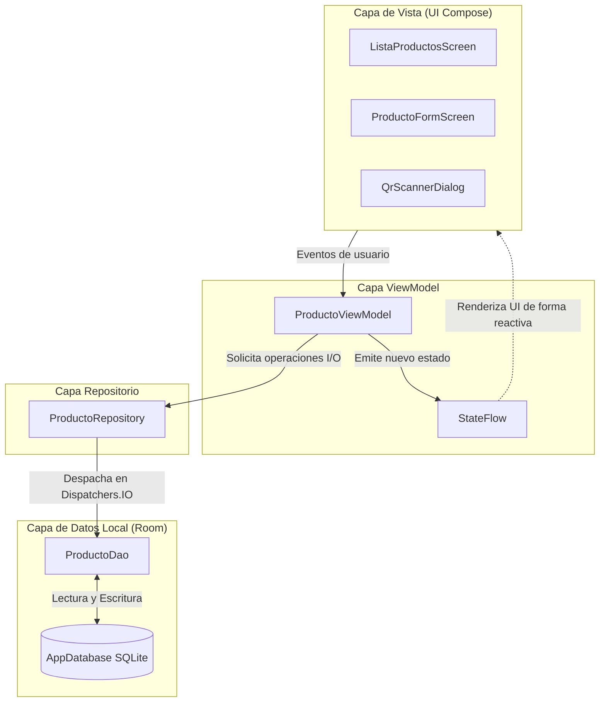

# DOCUMENTACIÓN TÉCNICA DE HITOS DE DESARROLLO
## Caso: Gestión de Inventario para Taller Mecánico Automotriz (Puente Alto)
### Asignatura: DSY1105 - Duoc UC | Primera Entrega: Módulo de Productos y Persistencia

---

## 1. Estructura del Proyecto

El proyecto implementa una arquitectura modular basada en buenas prácticas de desarrollo Android moderno y principios Clean Architecture, asegurando alta cohesión y bajo acoplamiento:

```text
app/src/main/java/com/taller/inventario/
├── data/
│   ├── local/
│   │   ├── ProductoEntity.kt          # Definición de tabla Room con reglas del taller
│   │   ├── ProductoDao.kt             # Consultas SQL, reactividad Flow y operaciones CRUD
│   │   └── AppDatabase.kt             # Singleton Room Database con callback de precarga inicial
│   └── repository/
│       └── ProductoRepository.kt      # Abstracción de datos ejecutada en Dispatchers.IO
├── ui/
│   ├── navigation/
│   │   ├── AppNavigation.kt           # NavHost y orquestación de destinos Compose
│   │   └── Screen.kt                  # Rutas y argumentos tipados
│   ├── theme/
│   │   ├── Color.kt                   # Paleta rojo automotriz / carbón slate / semántica MD3
│   │   └── Theme.kt                   # Configuración de MaterialTheme (Light / Dark)
│   └── producto/
│       ├── ProductoUiState.kt         # Estado inmutable, campos desacoplados y flags
│       ├── ProductoViewModel.kt       # Reglas de negocio, validaciones y StateFlow
│       ├── ListaProductosScreen.kt    # Listado, búsqueda interactiva, filtros y FAB
│       ├── ProductoFormScreen.kt      # Formulario estructurado con errores inline
│       └── components/
│           ├── ProductCard.kt         # Tarjeta con especificaciones técnicas, precios y bodega
│           ├── QrScannerDialog.kt     # Visor nativo CameraX + ML Kit Barcode Scanning
│           └── StockBadge.kt          # Insignia accesible (color + icono + texto)
├── InventoryApplication.kt            # Contenedor de dependencias Application (Singleton)
└── MainActivity.kt                    # Punto de entrada de la actividad y composición raíz
```

### Responsabilidades por Paquete:
- **`data/local`**: Almacenamiento persistente mediante SQLite/Room. Mantiene la integridad de datos del taller automotriz.
- **`data/repository`**: Única fuente de verdad para la capa de presentación. Abstrae la base de datos y garantiza que las operaciones se ejecuten en hilos de fondo (`Dispatchers.IO`).
- **`ui/producto`**: Presentación reactiva construida 100% en Jetpack Compose, con soporte para Material Design 3.
- **`ui/navigation`**: Gestión de rutas declarativas con argumentos opcionales.

---

## 2. Arquitectura MVVM (Model - View - ViewModel)

El proyecto aplica rigurosamente el patrón **Model-View-ViewModel (MVVM)** desacoplado:



- **Vista (Compose Screens)**: Componentes sin estado (`stateless`) que observan `ProductoUiState` mediante `collectAsState()`. No contienen lógica de negocio ni persistencia.
- **ViewModel (`ProductoViewModel`)**: Gestiona la lógica de presentación, valida los datos ingresados y transforma los flujos de Room en estado consumible por Compose.
- **Repositorio (`ProductoRepository`)**: Encapsula el acceso al DAO y garantiza que ninguna operación de base de datos bloquee el hilo principal (`Main Thread`).
- **Modelo (`ProductoEntity`)**: Representa la estructura de datos pura persistida en la base de datos local.

---

## 3. Navegación

La navegación está construida utilizando `androidx.navigation:navigation-compose`:

- **Definición de Rutas (`Screen.kt`)**:
  - `Screen.ListaProductos`: Ruta base `"lista_productos"`.
  - `Screen.ProductoForm`: Ruta con argumento opcional `"producto_form?codigo={codigo}"`.
- **Navegación Parametrizada**:
  - Para **Crear**: Se invoca `Screen.ProductoForm.createRoute(null)`, lo que reinicia el estado a un formulario en blanco.
  - Para **Editar**: Se invoca `Screen.ProductoForm.createRoute(codigo)`, cargando reactivamente la entidad correspondiente desde Room.
- **Transiciones y Retorno**:
  - Al completar la creación o edición con éxito, se invoca `navController.popBackStack()`, devolviendo al operario al listado principal con actualización reactiva instantánea.

---

## 4. Listado de Productos

Pantalla `ListaProductosScreen.kt` diseñada para el ambiente exigente de un taller mecánico automotriz:

- **Encabezado Automotriz**: Identificación institucional del taller en Puente Alto con paleta roja de alta visibilidad.
- **Búsqueda Reactiva Multicriterio**:
  - Filtro dinámico en tiempo real por **código**, **nombre**, **marca** o **categoría**.
  - Botón integrado en la barra de búsqueda para **abrir directamente el escáner de cámara** y filtrar al instante por el repuesto escaneado.
- **Filtros por Categoría**:
  - Fila horizontal de `FilterChip` ("Todos", "Aceites y Lubricantes", "Filtros", "Frenos", "Encendido", "Accesorios", "Bajo Stock / Crítico").
- **Visualización con `LazyColumn` y `ProductCard`**:
  - Despliegue de tarjetas de alto contraste con bordes tenues.
  - Información mostrada: Marca destacada, nombre técnico, código QR/barra, categoría, stock actual con unidad de medida, umbral mínimo, precios de venta y costo, ubicación física exacta en bodega (Zona, Estante, Repisa) y proveedor principal.
- **Regla de Reposición Automática Mínima**:
  - Campo calculado dinámicamente:
    $$\text{cantidadSugeridaReposicion} = \max(0, (\text{stockMinimo} \times 2) - \text{cantidad})$$
  - Si el cálculo arroja $> 0$, se despliega un contenedor informativo con la sugerencia exacta de reposición (ej: `"Sugerencia Reposición: Pedir 9 Unidad"`).
- **Control de Eliminación Segura**:
  - Botón de papelera con `AlertDialog` de confirmación que previene eliminaciones accidentales de inventario.

---

## 5. Formulario de Productos

Pantalla `ProductoFormScreen.kt` organizada en 3 secciones funcionales:

1. **Identificación del Repuesto**:
   - Campo Código con botón de acceso a escáner de cámara CameraX para autorrellenado. Si está en modo edición, el código permanece protegido como clave primaria inmutable.
   - Nombre técnico del repuesto.
   - Marca automotriz (ej. Castrol, Bosch, Mann Filter).
   - Selector desplegable (`ExposedDropdownMenuBox`) con categorías automotrices predefinidas.
   - Selector de Unidad de Medida (Bidón 4L, Litros, Unidad, Kit, Juego, etc.).
2. **Inventario, Stock y Precios Referenciales**:
   - Cantidad actual y Stock Mínimo con teclado numérico.
   - Tarjeta interactiva con vista previa en tiempo real de la reposición sugerida según la fórmula de reposición.
   - Precio Compra Referencial y Precio Venta Referencial con teclado decimal.
3. **Ubicación Física en Bodega y Proveedor**:
   - Sector/Zona (ej. "Zona A - Lubricantes").
   - Estante (ej. "Estante 01").
   - Repisa/Nivel (ej. "Nivel 2").
   - Proveedor asignado (ej. "Lubricentro Central SpA").

---

## 6. Validaciones en Formulario

Implementación de validaciones estrictas en `ProductoViewModel.kt` según las directrices del caso:

- **Reglas Validadas**:
  1. **Código Obligatorio y Único**: No puede estar vacío. Al crear, se verifica en Room que no exista previamente.
  2. **Nombre Obligatorio**: No puede estar en blanco.
  3. **Marca Obligatoria**: Campo requerido (ej. "Bosch", "Castrol").
  4. **Categoría Obligatoria**: Campo requerido.
  5. **Stock Actual**: Entero $\ge 0$.
  6. **Stock Mínimo**: Entero $\ge 0$.
  7. **Precios Referenciales**: Valores numéricos $\ge 0$.
  8. **Regla Financiera**: $\text{precioVenta} \ge \text{precioCompra}$ (no se permite venta bajo costo).
- **Integración Visual en Jetpack Compose**:
  Cada campo integra el manejo estandarizado:
  ```kotlin
  isError = state.campoError != null,
  supportingText = {
      state.campoError?.let {
          Text(it, color = MaterialTheme.colorScheme.error)
      }
  }
  ```

---

## 7. Gestión de Estado (StateFlow y ProductoUiState)

- **Inmutabilidad y Reactividad**:
  - `ProductoUiState` es una `data class` inmutable que contiene todos los campos desacoplados en String, banderas de estado (`isLoading`, `guardando`, `isEditing`, `mostrarScanner`) y errores independientes.
  - El ViewModel expone `StateFlow<ProductoUiState>` mediante `asStateFlow()`.
- **Actualización Automática de Estado de Inventario**:
  Al ingresar o modificar cantidad y stock mínimo, el sistema recalcula automáticamente el estado:
  - $\text{cantidad} = 0 \longrightarrow \text{"AGOTADO"}$
  - $\text{cantidad} \le \text{stockMinimo} \longrightarrow \text{"BAJO\_STOCK"}$
  - $\text{cantidad} > \text{stockMinimo} \longrightarrow \text{"DISPONIBLE"}$

---

## 8. Persistencia Local con Room

- **Entidad (`ProductoEntity.kt`)**: Mapea la tabla `"productos"` con clave primaria `codigo: String`.
- **DAO (`ProductoDao.kt`)**: Métodos con consultas reactivas mediante Kotlin `Flow`:
  - `getAllProductos(): Flow<List<ProductoEntity>>`
  - `getProductoByCodigo(codigo: String): ProductoEntity?`
  - `insertOrUpdate(producto: ProductoEntity)`
  - `delete(producto: ProductoEntity)`
  - `searchProductos(query: String): Flow<List<ProductoEntity>>`
  - `getProductosBajoStock(): Flow<List<ProductoEntity>>`
- **Precarga Inicial (`AppDatabase.kt`)**:
  Mediante el callback `RoomDatabase.Callback().onCreate`, se ejecuta una precarga en segundo plano (`Dispatchers.IO`) con 5 productos representativos del taller automotriz de Puente Alto:
  1. `LUB-CAST-5W30`: Aceite Sintético Castrol EDGE 5W-30 (14 un., Disponible)
  2. `FIL-MANN-W712`: Filtro de Aceite Blindado W712/22 (3 un. / Mín 6, Bajo Stock)
  3. `FRE-BOSCH-DOT4`: Líquido de Frenos DOT 4 Racing 500ml (8 un., Disponible)
  4. `BUJ-DENSO-IK20`: Bujías de Encendido Iridium Power IK20 (0 un., Agotado)
  5. `FRE-BREM-P060`: Pastillas de Freno Cerámicas Delanteras Brembo (5 un., Disponible)

---

## 9. Integración de Cámara (Recurso Nativo: CameraX + ML Kit)

Componente nativo `QrScannerDialog.kt` embebido en Jetpack Compose:

- **Compatibilidad de Formatos**:
  - Configurado con `Barcode.FORMAT_ALL_FORMATS`, lo que permite escanear tanto códigos QR 2D como códigos de barra 1D estándar en el rubro automotriz (EAN-13, EAN-8, CODE-128, UPC-A, UPC-E).
- **Procesamiento en Tiempo Real**:
  - `PreviewView` de CameraX acoplado a `ImageAnalysis` con `STRATEGY_KEEP_ONLY_LATEST`.
  - Los frames se entregan a `BarcodeScanning.getClient().process(image)` en un hilo dedicado (`Executors.newSingleThreadExecutor()`).
- **Manejo de Permisos en Runtime**:
  - Detección automática mediante `rememberLauncherForActivityResult(ActivityResultContracts.RequestPermission())`. Si el operario no ha otorgado el permiso, se presenta una pantalla clara con botón de activación.
- **Feedback Sensorial al Operario**:
  - **Háptico**: Vibración táctil mediante `HapticFeedbackType.LongPress`.
  - **Sonoro**: Notificación acústica clara tipo pitido de terminal POS mediante `ToneGenerator(AudioManager.STREAM_NOTIFICATION, 100)`.
- **Controles de Bodega**:
  - Botón para encender/apagar la linterna (Flash/Torch) para lectura en bodegas automotrices oscuras.
  - Marco guía de puntería con bordes redondeados en rojo corporativo.

---

## 10. Pruebas de Funcionamiento y Evidencias

Guía para ejecutar y verificar las funcionalidades clave durante la evaluación:

### Paso 1: Precarga Inicial y Listado Reactivo
1. Instalar y abrir la aplicación en el dispositivo o emulador.
2. Comprobar que aparecen los productos precargados del taller automotriz (Castrol, Mann Filter, Bosch, Denso, Brembo).
3. Verificar que los badges reflejan correctamente el estado:
   - Verde con icono de visto: "Disponible".
   - Amarillo/Naranja con icono de advertencia: "Bajo Stock".
   - Rojo con icono de error: "Agotado".
4. Verificar que se despliega la **sugerencia de reposición** en los productos con stock comprometido.

### Paso 2: Filtros y Búsqueda
1. En la barra de búsqueda superior, escribir `"Mann"` o `"W712"`: la lista debe filtrar inmediatamente mostrando únicamente el filtro de aceite.
2. Borrar el texto con el botón "X".
3. Tocar el chip de categoría `"Bajo Stock / Crítico"`: la lista mostrará únicamente los repuestos que se encuentran igual o por debajo de su umbral mínimo.
4. Tocar `"Todos"` para restablecer.

### Paso 3: Registro de Nuevo Producto (Validaciones y Cámara)
1. Presionar el botón flotante `+`.
2. Probar presionar `"Guardar"` sin ingresar datos: verificar que los campos obligatorios muestren los mensajes de error en rojo.
3. Probar ingresar un precio de venta menor al de compra (ej. Compra $10.000 y Venta $8.000): verificar que aparezca el error de validación financiera.
4. Presionar el botón de cámara al lado del campo "Código":
   - Conceder permiso de cámara.
   - Apuntar a un código de barras o QR de prueba.
   - Al detectar el código, se emitirá un beep sonoro y vibración, cerrándose el diálogo y autorrellenando el código.
5. Completar los datos requeridos y presionar `"Guardar"`: la aplicación regresará a la lista y el nuevo repuesto aparecerá inmediatamente en la base de datos Room.

### Paso 4: Edición de Producto
1. En cualquier tarjeta de producto, pulsar el icono del lápiz (Editar).
2. Modificar la cantidad en inventario o el precio.
3. Presionar `"Actualizar"`: comprobar que el cambio se refleja en la lista y el badge de stock se actualiza automáticamente.

### Paso 5: Eliminación Segura
1. Pulsar el icono de papelera en un repuesto.
2. Verificar la aparición del cuadro de diálogo de confirmación.
3. Presionar `"Cancelar"` para verificar que no se borra.
4. Presionar nuevamente la papelera y confirmar con `"Eliminar"`: el repuesto desaparece de la vista.

### Paso 6: Persistencia tras Cierre de la Aplicación
1. Cerrar completamente la aplicación (incluso desde la vista de aplicaciones recientes).
2. Volver a abrir la aplicación: verificar que los cambios realizados (productos agregados, editados o eliminados) persisten intactos en la base de datos SQLite local de Room.
